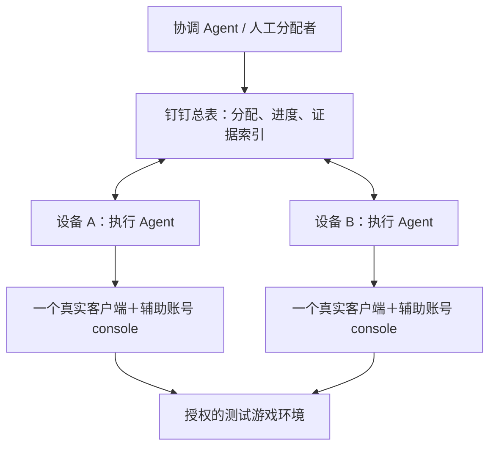

# K1 多 Agent 验收：钉钉总表＋单客户端与 console 配合

设计修订 v3.6 · 2026-10-21 · 明确用户配置 MCP、skill 声明运行依赖 · 未实施、未试写、未运行验收

**目标：各协作 Agent 从同一张总表取得任务，独立完成一个场景并更新进度；多人玩法由该 Agent 用一个真实客户端和多个辅助账号 console 完成。需要观察不同角色的客户端表现时，互换角色、分轮执行。**

本文是待评审的落地方案。钉钉表仅作只读示例，没有领取真实任务、改状态或新建工作表。没有启动 console、登录游戏、修复 Unity 连接或部署服务。本文中的操作步骤描述后续实施，不构成本次执行指令。

本公开版本保留当前协作设计与演示，不包含内部任务来源标识、个人设备盘点、内网接口或旧版原始附件。完整内部工作稿保留在本地。

具体填写与流转见 [597 版本六列示例](k1-597-collaboration-example.md)：以匿名化条目 DEMO-ISSUE-01 为示例，演示六列、关联计划、执行记录及领取/断线/报告更新。所有执行身份与结果均为演示，未写入在线表。

## 1. 已确认方向与建议取舍

| 项目 | 本版安排 | 确认程度 |
| --- | --- | --- |
| 总表 | 以钉钉在线表格为入口，记录任务、负责人、进度和证据链接。 | 用户已指定平台；示例已只读核查。 |
| 表格接入 | 优先复用官方钉钉电子表格 MCP；DWS sheet 可作为现有 CLI 封装入口。无需自建表格读写服务。 | 官方服务已核实存在；本会话直接 MCP 接入尚未验证，DWS 读取已成功。 |
| 并行单位 | 一个 Agent 负责一个完整场景及其各观察轮次；多个 Agent 并行处理互不冲突的任务。 | 按用户简化方案。 |
| 多人玩法 | 一个真实客户端承担本轮被观察角色；console 承担其他参与者。 | 按用户方案。 |
| 双方客户端表现 | 下一轮让真实客户端承担另一业务角色，console 承担配合角色，重复正常业务链路。 | 按用户最新补充。 |
| 首期领取 | 验证前由一个分配者预分配；自主领取优先验证官方 `replace_all` 的单单元格精确条件替换，通过验证后再启用。 | 已找到官方原子替换声明和 MCP 参数；当前租户的并发领取语义尚未实测。 |
| 统一表结构 | 六个“协作”专用字段必需；其余展示列可选，详细内容放入冻结计划和执行记录/报告。每会话检查，唯一初始化会话补缺列。 | 用户已确认六列方案；原业务字段保留，尚未修改在线表或 skill。 |
| 表组织 | 建议在同一文档下增加专用“Agent验收任务”工作表，原版本清单保留业务含义。 | 待评审建议；未新建，名称不是已存在的 sheet。 |
| 协调职责 | 一个协调 Agent 或人工分配者负责拆任务、资源分配、改派、证据复核和汇总；可与设备 A 同机。 | 最小实施建议，无需第三台设备。 |
| 网络 | 各设备各自能访问钉钉和测试游戏环境即可；游戏内网按公司局域网/VPN 接入。 | 不再需要传播设备 A 的调度服务地址。 |

本版不要求部署新的调度服务。这里的 console 是仓库已有的协议测试程序，连接已有游戏服务；并非再部署一套游戏服务器。具体环境是否支持所需 console 协议、登录方式和账号权限仍需验证。

表保存分配与进度；本地操作日志保存动作事实；证据包保存断言依据。三者用稳定 ID 关联。表内写了“通过”本身不构成验收证据。

## 2. 钉钉示例：已核实的结构和接口边界

来源采用内部在线表格的只读核查经验；公开版仅保留表类型、字段语义和接口结论，不包含该表的链接、节点标识或真实任务数据。示例批次 597 仅用于说明。

### 官方 MCP 与本机会话接入状态

**钉钉官方提供电子表格 MCP，适用于本例的 axls。** [阿里云官方接入文档](https://help.aliyun.com/zh/dts/user-guide/transfer-the-data-of-dingtalk-to-dts-ragflow) 明确区分文档 MCP 与电子表格 MCP，并说明它们各有独立 Endpoint；[百炼官方连接说明](https://docs.agent.bailian.aliyun.com/zh/connector/apps/dingtalk) 分别列出钉钉文档、钉钉表格和钉钉 AI 表格，钉钉表格支持电子表格读写。不能把普通表格与 AI 多维表混为一谈。

2026-10-21 只读核对本机 Codex 配置中的服务名称和本会话工具目录：已见 dingtalk-docs、日志、机器人等，尚未发现直接暴露的电子表格工作表/区域工具。这只是**当前配置与会话可见性**，不能推断官方不提供该能力，也不能推断用户账号没有开通。没有修改 MCP 配置、开通服务或重置凭据。

用户已明确：**每位用户在自己的 Agent 宿主环境中管理 MCP 配置 JSON（或该宿主支持的配置形式）和登录授权；skill 只声明运行依赖并检查当前会话是否具备所需能力。** 公共服务地址可以相同，但不把某个人的配置文件、账号授权或登录态分发给其他协作者。

用户提供的 `https://mcp-gw.dingtalk.com/oauth/server/sheet` 作为服务接入线索保留；具体配置由各端维护，不作为 skill 内置配置或统一模板下发。skill 不负责安装 MCP、修改用户配置、复制认证信息或管理 OAuth 登录；当前也未配置或连接该地址。

### skill 中的运行依赖说明

| 依赖 | 需要的能力 | 运行时处理 |
| --- | --- | --- |
| 用户已配置并授权的电子表格工具 | 读取目标工作表、完整表头与区域，按精确范围写回；缺列时还需具备追加列/扩容能力及权限。 | 从当前会话实际暴露的工具与 schema 核对能力，并检查目标访问情况；不按本机服务别名必须叫“钉钉表格”来判断，也不要求读取用户配置文件。缺少某能力时说明受影响步骤和配置要求，不自动修改环境。 |
| 计划与证据存储访问 | 读取冻结计划，持久化及回读执行记录、报告和历史版本。 | 使用每位用户自己的授权，核对本任务入口可访问；共享的是任务资料，不是凭据。 |
| 自主领取的条件替换（仅启用该模式时） | 经 Q01～Q06 验证的单控制格精确条件替换。 | 不满足时保持预分配；缺少基础写回能力时不能进入执行流程。接口可见不等于并发语义已验证。 |

日常依赖检查采用工具发现与只读探测，不为检查是否可用而随意试写业务表。实际写入只发生在已授权的补列/协作步骤或后续测试副本验证中。已有并完成本用户认证的 DWS 可作为兼容入口，不是每位用户都必须安装的额外依赖。缺少依赖时给出缺项及配置指引，用户补好后重新检查。

[DWS 官方项目的封装说明](https://github.com/DingTalk-Real-AI/dingtalk-workspace-cli/blob/main/docs/shortcut-report.md) 说明 CLI 可通过既有 MCP 通道调用能力。因此“使用 DWS”和“复用官方 MCP”并非互斥方案；后续核实执行 Agent 的实际工具和参数后选择直接 MCP 或现有 CLI 入口。现有读写能力不需要重新开发，只需编排任务身份、字段映射、执行流程和证据规则。

后续职责顺序：各用户在宿主中完成工具配置与授权 → skill 发现现有工具并核对真实 schema → 只读检查目标表 → 经实施授权在测试副本验证写入和并发。**已找到可构造条件领取的原子替换能力，尚未取得当前租户的并发运行证据。** 不能只依据普通区域更新缺少版本条件，就否定另一个 MCP 工具 `replace_all` 的条件替换能力。

### 原子领取核查结论（2026-10-21，只读）

**结论：官方提供“精确匹配后替换”的服务端原子操作，可作为单单元格条件领取的候选基础；没有查到专门的任务 claim/租约接口，也尚未证明当前服务在竞争、重试和回包丢失时符合任务领取合同。** 应区分“文档声明的原子替换”与“本环境已验证的安全抢领”。本次没有调用任何写接口，不把设计推导写成实测通过。

核查固定到官方仓库 `DingTalk-Real-AI/dingtalk-workspace-cli` 的提交 `54a46921a2e5d074628afeb205adb4ccffef6ea1`。本机 DWS 实际版本为 `v1.0.35 (e7a3010, 2026-06-09)`，不能把远端新版参数直接套给旧二进制；本次未升级。

| 核查对象 | 官方资料或源码事实 | 对领取的结论 |
| --- | --- | --- |
| 普通区域更新 | 所查 `range update` 调用按区域提交新值，未见 expectedRevision/expectedValue 条件。[固定版本源码](https://github.com/DingTalk-Real-AI/dingtalk-workspace-cli/blob/54a46921a2e5d074628afeb205adb4ccffef6ea1/internal/helpers/sheet_range_ops.go#L253) | 不适合用“先读空闲，再普通覆盖”的方式抢任务。此结论限于已查接口。 |
| 精确替换 | 官方说明标为“服务端原子操作”，支持限定 range、整格匹配、大小写匹配，返回 `replaceCount`。[官方说明](https://github.com/DingTalk-Real-AI/dingtalk-workspace-cli/blob/54a46921a2e5d074628afeb205adb4ccffef6ea1/skills/mono/references/products/sheet/sheet-search-replace.md) | 有条件替换的正面依据。将唯一 free 令牌替为携带 owner/claimId 的 held 令牌，可以作为领取方案；并发唯一赢家仍待验证。 |
| MCP 映射 | CLI 将参数组成一次 `replace_all` 调用，而非客户端先读后写；工具合同的通用 `Idempotency` 标为 `unknown`。[调用源码](https://github.com/DingTalk-Real-AI/dingtalk-workspace-cli/blob/54a46921a2e5d074628afeb205adb4ccffef6ea1/internal/helpers/sheet_data.go#L154) | 单次 MCP 请求是候选比较并替换点；不能假设超时自动重试天然幂等。 |
| 精确条件参数 | 已查映射为 nodeId、sheetId、range、text、replaceText、matchCase、matchEntireCell、useRegExp 等。[参数构造源码](https://github.com/DingTalk-Real-AI/dingtalk-workspace-cli/blob/54a46921a2e5d074628afeb205adb4ccffef6ea1/internal/helpers/sheet_batch.go#L837) | 领取要求整格精确、区分大小写、关闭正则；限定一个控制单元格，不能全表替换“待领取”。 |
| revision / changeset | 新版说明将其用于编辑审计和前向变化查询。[官方说明](https://github.com/DingTalk-Real-AI/dingtalk-workspace-cli/blob/54a46921a2e5d074628afeb205adb4ccffef6ea1/skills/mono/references/products/sheet/sheet-revision-changeset.md) | 读取 revision 不等于更新时校验 revision，不能单靠读两次版本实现排他领取。 |
| batch-update | 新版说明支持子操作失败时整批回滚，但未给出“替换 0 次必须让批次失败”的领取合同。[官方说明](https://github.com/DingTalk-Real-AI/dingtalk-workspace-cli/blob/54a46921a2e5d074628afeb205adb4ccffef6ea1/skills/mono/references/products/sheet/sheet-batch-operations.md) | 不把“条件替换＋无条件填写 owner”塞进批次就宣称安全；替换未命中可能仍是正常返回。 |
| 本机与真实服务 | 本机 `sheet replace --help` 已确认有 range、match-entire-cell、match-case、use-regexp 等参数。未读取目标表格 MCP 的完整实时 schema，也未做竞争试写。 | 已有验证入口，不需要为核查升级 CLI；真实返回格式、并发隔离、无匹配语义和重试边界仍待验证。 |

原子领取需要：在同一分配代次中，两名竞争者使用相同 free 令牌、不同 claimId，请求结束后至多一名取得所有权，且两者不能都被告知替换成功。官方的“原子”文字没有展开跨请求隔离或线性一致性保证，因此目前结论是**文档级可行、部署环境待验证**，不是“明确不支持”，也不是“已经安全可用”。

### 示例表结构与读取边界

普通在线电子表格使用 ALIDOC/axls 接口；实际 nodeId、sheetId 与表头行由各会话绑定。业务列可以包含序号、类型、内容、人员、状态、备注、需求单和合并信息。

序号可能由 `=ROW()-1` 计算，不能作 taskId；小范围样本中右侧为空，也不能证明整列空闲。完整表头、使用范围、保护区域、写权限和各参与者的访问能力均在真实接入时核对。本公开版不提供可直接执行的内部表地址或账号。

此前已取得读取证据，条件替换的公开资料依据见上节；真实写入、并发与恢复语义仍须在获准测试副本验证。

### 原表字段如何衔接

| 原字段 | 在协作方案中的作用 |
| --- | --- |
| 类型、内容、JIRA单 | 任务来源。将业务条目拆为可验收场景，保留原始需求引用和内容指纹。一个 JIRA 可以对应多个场景，不能单独当唯一 taskId。 |
| 跟进人、经办人、验收人 | 保留原团队人员职责。执行 Agent 身份记录在领取令牌，负责人可另列展示；不能把“验收人”自动当作执行进程身份。 |
| 状态、备注 | 保留业务流程含义。首期由协调者复核后汇总，不让多个 Agent 自行覆盖。 |
| 合并状态、合入dev时间 | 用于了解进包背景；不能代替客户端/服务端/配置实际部署版本。 |
| 序号 | 保留展示用途，新增不可变 sourceItemId 或任务来源快照，避免插行后错误关联。 |

建议同一文档内新增专用任务工作表，做到“一条场景一行”。拆分后的多个任务共享来源引用，但各有唯一 taskId。首次建立映射时由协调者核对；原条目尚无稳定 ID 时，保存 sheetId、JIRA、内容指纹和当时行号辅助定位，发现不唯一或内容变化必须重新核对。行号只作提示。

## 3. 一台真实客户端如何覆盖多个角色

**业务角色和设备分离。** “发起者”“接收者”“队长”“队员”是本轮业务身份，不固定绑定设备 A/B。设备 A、B 各自可以完整执行一个多人场景，两台设备用于提高独立任务吞吐。

以普通联盟邀请为例，建议分为以下两轮。账号和联盟均须满足真实前置，具体名单尚未选定。

| 轮次 | 真实客户端承担 | console 承担 | 本轮要验证 |
| --- | --- | --- | --- |
| P1：发起视角 | 有邀请权限的邀请者；从正常 UI 发邀请。 | 无盟接收者；等待本次通知，按正常协议接受。 | 邀请操作、发起端反馈、对方接受后的发起端列表/状态刷新，以及服务端成员关系。 |
| P2：接收视角 | 无盟接收者；观察邀请提示/列表，从正常 UI 接受。 | 有权限的邀请者；发出本轮邀请。 | 接收端通知、提示/列表、接受入口和加入后的客户端表现，以及服务端成员关系。 |

真实客户端可以通过合法换号承担另一角色，也可以用另一组符合条件的账号重新执行；不要求复用同一玩家。**上一轮已加盟的账号不再满足下一轮“无盟”前置，不能直接重放。** 优先使用预先准备的另一组账号；若需要退盟、清数据、改权限等恢复动作，应作为明确的 fixture/cleanup 单独登记，不能悄悄执行。

每轮独立绑定角色→playerId→真实客户端/console 会话，确认 SID、联盟、邀请历史、版本和观察通道后才发起动作。换号前结束该账号旧 console 会话，避免同账号并发登录。角色变化后旧的就绪标记、消息缓冲和关联上下文全部失效。

### 分轮覆盖的判定规则

- 计划预先列明每条断言由哪一轮、哪个角色、哪种证据覆盖；每轮都要重新完成真实业务过程，不以 console 伪造 UI 事件。
- 两轮使用同一冻结需求/版本基线及可比较前置，分别保存 roundId。按计划汇总角色覆盖，不能把两个独立事件描述成同一次双端观察。
- 如果原断言只是“发起者显示 X，接收者显示 Y”，可以拆成 P1/P2 分别验证；如果明确要求同一次事件中的两端显示一致、端到端时序差或双端竞态，先保留该断言，再判断是否需要两个真实客户端。
- console 可覆盖参与行为、协议和服务端结果；客户端 UI、动画、渲染、平台 SDK 等由相应轮次的真实客户端覆盖。不能覆盖的断言明确保留未验证，不静默缩小需求。
- 原计划要求 Android/iOS 或不同构建的表现时，按对应真实运行平台分别观察。互换角色本身不增加平台覆盖。

### console 适配必须核对的行为

| 能力 | 要求 |
| --- | --- |
| 构建与版本 | 记录 console 的源码/构建身份；不能用测试程序的版本号证明真实客户端兼容性。 |
| 账号独占 | 核实登录是否会挤掉同账号其他会话；真实客户端与辅助进程使用独立账号。 |
| 角色身份 | 查询某玩家不代表切换操作者，优先采用一个账号一个持久会话。 |
| 异步协议 | 请求发出、退出码或单个响应都不能直接当业务成功；保持接收通道并核对最终状态。 |
| 日志与恢复 | 持续记录任务、批次、轮次、操作及会话身份，识别被踢、断线、未知结果和采集缺口。 |

console 尽量走正常业务协议。另有授权时可准备前置，但直接改最终状态不能证明正常业务链路通过。实际命令、协议和登录能力由各项目自行验证，内部源码定位不随本公开版发布。

## 4. 总表任务合同：预分配兜底，条件替换作为自主领取候选

### 六个固定字段与会话入场

字段的唯一规范见 [协作验收任务表字段合同](k1-collaboration-task-table-contract.md)，版本为 `acceptance-collab/2`。**总表只要求六列：协作任务ID、协作验收计划、协作领取令牌、协作执行状态、协作证据链接、协作更新时间。** 负责人和结果等独立展示列全部可选，入场不主动补齐可选列。

六列分别映射 taskId、planRef、claimState、taskState、evidenceRef、updatedAt。本文其余内部键仍用于合同，但不再一一对应表列：owner/assignmentId/sessionId/attemptId 在令牌中，来源/planRev/资源在冻结计划中，reportId/结果/阻塞详情/复核在执行记录与报告中。原 21 项的完整归并见字段合同，不通过删掉恢复信息来减少列数。

[597 填写示例](k1-597-collaboration-example.md) 给出完整六列表格、令牌展开、计划和执行记录的组织方式及逐阶段更新表。该例不指定追加列的坐标，也不将表内业务状态自动改为协作状态。

专用工作表和原表追加六列都适用；原“验收人、状态、备注”等业务含义保留。计划入口须有可校验的冻结内容，证据入口须从开工前就能保存执行记录，不能到最终报告完成才填入。

每个新会话、恢复会话或换表会话先执行：**绑定 nodeId/sheetId/表头行 → 完整检查六列 → 补齐缺列 → 回读核对 → 校验令牌、计划和本次执行记录 → 领取或恢复**。已有字段不改，缺业务内容则保持待配置。可选列不存在或展示滞后，不改变令牌/报告的权威性。

所有 Agent 都检查；结构修改由唯一初始化会话串行完成，默认由发起协作的会话承担，有执行者时先取得停写确认。这是一次性职责，**无需启动协调者服务**；表中一个“初始化中”标记不构成锁。重复表头、类型/版本冲突、权限不足或写入结果不明时先报告核对，不盲目重试。

设备 A/B 只是展示名，owner 唯一标识执行 Agent，sessionId 进一步绑定一个逻辑会话；本地互斥确保同一会话没有两个活动进程。单靠人名、设备名、进度列或“负责人”展示列都不能授予执行权。

### 推荐的采用顺序

1. **验证前使用预分配。** 单分配者向指定会话发布完整 held 令牌，执行者只取自己的任务，不争抢空白行。
2. **自主领取优先验证 replace_all，无需先建设调度服务。** 后续获准实施时，先用测试副本完成 Q01～Q06，通过后再启用单控制格精确条件替换。
3. **接口不满足或结论仍不明确时继续预分配。** 协调 Agent 可串行分配，执行者并行处理无冲突任务；仅在确需无中心竞争且官方工具不足时，再评估其他原子存储。

### 验证前的预分配流程

前置：六列入场检查通过，本次任务范围明确。原独立 assignmentState 列取消，发布门合并到 claimState；没有有效 held 令牌就不能开工。

1. 分配者生成 assignmentId，保存冻结计划及资源快照，建立本任务证据入口，核对其可访问性；从目标执行会话取得预先生成并持久化的 owner/sessionId/attemptId。
2. 在任务尚未运行的窗口设置计划、证据入口和“待开始”，最后写完整 held 令牌并回读。held 绑定 taskId、assignmentId、planDigest、owner、sessionId、attemptId；中途失败或令牌不完整均不开工。
3. 指定执行者自行回读完整令牌，核对稳定 taskId 唯一、冻结计划摘要及资源无冲突，在证据入口建立并回读本次执行记录，然后推进“执行中”。恢复已有执行走恢复合同，不创建另一批次重做。
4. 每次写回重新定位 taskId、核对表头和完整令牌，仅更新自己负责的最小单元格区域。计划/资源改变、身份不符或定位不唯一时停止；不覆盖新代次，不回写整行或整表。
5. 报告及 reportId、业务结果、复核记录放在证据入口。提交后置“待复核”；协调者核对具体报告及收尾，再关闭令牌并设置“已完成”，按团队规则汇总原业务表。

**这些是协作约束，不是服务端锁。** 写前查找、写后回读不能消除定位后他人插行的竞争。执行窗口冻结表布局及任务输入，结构维护先停写并得到各端确认。不能保证此条件时，应改为唯一表写入者代填，或使用已验证的稳定记录与条件更新接口。

预分配依赖唯一分配者、明确身份交接及冻结窗口，不是跨单元格事务；新代次不能在旧会话/在途结果不明时发布。在途同时包括游戏动作、表格及证据/索引写入，旧表写可能迟到时即使进程已停也不能覆盖发布。只有“读空闲→写姓名→回读姓名”不构成安全抢领。

### 待验证的自主领取合同：一个单元格决定归属

控制单元格使用与预分配相同的 v2 令牌结构。phase 为 draft/free/held/closing/closed，代替旧独立分配状态；详细类型和转义要求见字段合同。

~~~text
领取前：v2:free:<taskId>:<assignmentId>:<planDigest>:<空owner>:<空sessionId>:<空attemptId>
领取后：v2:held:<taskId>:<assignmentId>:<planDigest>:<owner>:<sessionId>:<attemptId>
~~~

上例是逻辑字段示意，空身份在实际编码中为空值。planDigest 覆盖冻结计划及资源快照；无需再把 planRev/resourceHash 分别放在表列或令牌里。attemptId 在领取前生成，同时作为 claimId；相同请求重试沿用同一个身份和完整原文。每次重新发布使用新 assignmentId，不能恢复旧代次的 free。空格或通用“待领取”不能作为比较条件。

拟议流程：

1. 协调者先冻结计划、核对不冲突资源并建立证据入口，确认 taskId 唯一和表布局稳定，最后发布本代次 free。领取模式已冻结，不能从空令牌推断模式。
2. 竞争者先持久化 attemptId/sessionId、预期 free 及拟写 held。向固定 nodeId/sheetId 的单一控制格发出一次 replace_all：text 为完整旧令牌，replaceText 为完整新令牌，matchEntireCell=true、matchCase=true、useRegExp=false；字段及隐藏格策略以实际 schema 为准。
3. 成功响应、replaceCount=1、回读完整 held 与本地身份相同，且计划/资源检查通过后，才登记本次执行记录；记录可回读后开工。替换 0 次须核对是他人持有还是本请求此前已成功，不能直接宣布取得归属。
4. 错误、缺计数、计数异常或回读不能证明归属，一律不开工，在本地保持待核对；失败竞争者不得覆盖当前持有者的状态或报告。回读不能补足普通覆盖写的竞争缺陷。
5. 丢响应时保留同一 attemptId，先核对完整 held；不生成新领取身份，也不因一次读到 free 就认定旧请求失败。无法排除迟到请求则保持未知；重试仅在 Q03 证明其语义后允许。
6. 已取得归属但执行记录/进度写回失败时，只补记录和索引，不重领、不重做游戏动作；若记录尚未就绪则还不能发出首个业务动作。

该原子点仅涉及一个任务控制格，不提供跨行/多资源事务，也不让游戏服务器识别过期执行者。不得把“替换 0 次”与后续无条件写合并后宣称安全。改派、取消及关闭均先确认旧会话停止和在途结果，再由协调者处理；不按更新时间自动抢占。

控制格不能被可选 owner 展示、人工清空、复制旧行或公式重算绕过。即使精确替换成立，也只约束遵守合同的执行者，不替代权限控制、结构冻结或旧进程停止证明。

### 后续测试副本验证门（本次均未执行）

| 编号 | 场景 | 必须取得的证据 |
| --- | --- | --- |
| Q01 | 实际 schema 与正反例 | 记录工具/CLI 版本、请求参数和原始响应。精确命中只改目标格，非匹配返回 0；大小写、前后缀、隐藏格及范围行为符合合同，其他行未变。 |
| Q02 | A/B 同代次竞争 | 两个真实调用身份用相同 free、不同 claimId 并发，覆盖不同到达顺序、多轮竞争；每轮只有一个替换成功且最终归属一致，失败者无游戏调用。有限测试不是形式证明，仍需官方合同支持隔离语义。 |
| Q03 | 丢响应、重复和迟到 | 同 claim 重试不产生第二持有者；回读 held 可对应原请求；延迟旧请求不会污染新代次。无法判定时保持未知，不启动业务。 |
| Q04 | 非法状态和表改动 | 重复 taskId、复制令牌、错行/错表、计数异常、公式格、执行窗口内结构改动均阻止开工或触发隔离，不能把回读当原子定位保证。 |
| Q05 | 失联与改派 | owner 超时不自动回收；旧会话停止和在途核对后生成新 assignmentId，旧令牌无法命中新代次；未知旧请求不允许自动释放。 |
| Q06 | 记录写回与资源冲突 | 控制格已归属而执行记录/进度或可选 owner 展示失败时只补记录，首个业务动作须等记录就绪；共享账号/联盟冲突不能因分别领取成功就同时开工。 |

通过标准须包含官方对精确替换的并发隔离语义说明或相应服务实现依据，以及目标租户的上述验证记录。当前资料给出的原子操作表述是正面依据，但未展开并发语义；如无法补强，继续采用预分配，不用少量竞争“碰巧没冲突”代替保证。

### 状态、超时与资源

任务执行状态固定为：待配置 → 待开始 → 执行中 → 待复核 → 已完成；异常为阻塞、待核对、已取消。业务结果“未验 / 通过 / 不通过 / 不完整”分别映射 manifest 的 not_run / passed / failed / incomplete，放入报告；复核状态、身份、意见及所复核报告的摘要放入复核记录。两者都不再是必需表列。任务已完成仍可能业务不通过，单独修改表状态不能替代报告与复核。

更新时间只作失联提示，**不作自动到期转让的租约**。超时后标记疑似失联，停止继续分配有冲突的资源；先确认旧执行者和旧 console 已停止、在途操作已核对，再产生新 assignmentId。无法证明停止则隔离任务和资源，不因换了任务 ID 就解锁。

账号、联盟、活动、地图对象和全服时间均可能共享。并行任务必须有不冲突的 resourceRef；同 SID 并不天然冲突，不同账号也不天然安全。改服时间、重置活动、清档、热更/重启等环境级动作由唯一环境负责人安排，在所有受影响任务停止且在途结果明确后才考虑执行，且沿用对应操作授权。

## 5. 本地同步、断线恢复与证据合同

### 本地角色同步

不再做跨设备 A/B 屏障；单个执行 Agent 按步骤控制真实客户端及辅助 console。每轮遵循：身份/前置核对 → 观察通道就绪 → 发起动作 → 等待匹配响应/通知 → 接收方动作 → 双角色状态及服务端结果核对 → 采集 UI → 收尾。

本地步骤依赖仍然必须显式满足。console 已登录不等于接收方监听已建立；同类型通知不一定来自本次操作。现有邀请路径尚未确认唯一 inviteId，需独占账号/联盟、排除旧邀请，并用目标玩家、联盟、前后状态与时间范围关联；存在多个可能来源时保留 incomplete。

### 操作与恢复

证据入口在发布时建立，本次执行记录在首个业务动作前建立并回读。每个可能改变游戏状态的操作，先将 operationId、请求摘要和前置持久化到本地及该入口下的执行日志，确认可回读后再发送；后续持续追加 dispatched → verification_pending → verified/failed，结果不明用 outcome_unknown。共享记录不可用时暂停新业务动作，已发动作继续采证核对。只有 prepared/操作意图不证明尚未发送；operationId 是关联 ID，不能假设游戏服务按它去重。

| 中断位置 | 恢复方式 |
| --- | --- |
| 可证明尚未发送 | 核对完整令牌、计划、身份和前置后决定是否继续；只有操作意图而无回执不能证明未发送。 |
| 已发送但 Ack/Ntf 未落盘 | 保留 outcome_unknown；先查询权威状态和日志，不自动补发邀请、接受或奖励请求。 |
| console 退出、真实客户端重连/换号 | 旧 ready 失效，重建角色观察通道并核对旧请求；若涉及计划外账号/资源变化，先停止旧执行并发布新计划/代次。 |
| 钉钉读写失败 | 保留本地日志，暂停后续有副作用的步骤；已发动作继续采证/核对。网络恢复先核对分配和表状态，不能以“表没更新”推断游戏没执行。 |
| 执行记录/证据上传失败 | 暂停新业务动作，核对已发动作，仅补记录/证据；不得为了重传而重做游戏动作。 |
| 表写回响应丢失 | 回读六列和令牌，从证据入口核对 assignmentId/attemptId、reportId/报告摘要；只补缺失写回，不覆盖新分配。 |
| 换会话/设备接手、取消或改派 | 先停新动作、核对在途、确认旧会话及 console 已停止。接手发布新代次并链接旧记录，未知则隔离。取消不等于撤销游戏效果。 |
| 第二轮前置无法恢复 | 保留第一轮已验证断言和第二轮缺口，整体 incomplete；不得借用旧轮截图填充。 |

### 最小证据包

每个 task attempt 对应一个 manifest，列出计划要求的全部轮次；每轮证据包含：

- taskId、planRev/planDigest、assignmentId、attemptId、roundId；若同轮重试，追加 roundAttemptId，不覆盖旧失败或未知记录。
- deviceId、Agent/sessionId、角色→playerId/SID/联盟映射；真实客户端与各 console 的独立会话来源。
- 实际客户端构建/热更、服务端部署、配置基线及 console 构建标识。不能仅填本地分支名或 console 的 `99.0.0`。
- 前置与收尾状态、operationId、请求/回执/通知关联、权威业务状态、各断言结论；时钟与采集断档说明。
- UI 截图/录屏、console 原始日志、查询结果的文件列表、哈希、采集时间和可访问链接；哈希证明内容一致，不能单独证明行为真实。

总表保留一个任务级证据入口，按 assignmentId/attemptId 保存当前与历史执行记录，提交报告有独立 reportId、版本和内容摘要，复核绑定该具体报告；报告更改后旧复核不能自动沿用。只有本机文件路径不够供其他设备恢复或复核；须验证共享存储的权限、持久化写入和回读能力，位置待定。登录凭据、访问 Token 和会话秘密不写入总表或报告，领取令牌只是控制数据。

复核按“断言→轮次→角色→证据”逐项检查：允许计划内 P1/P2 汇总，禁止跨 assignment/未知 attempt/不同版本随意拼接。轮次重试需有明确取用记录，并保留未闭环问题；失败证据不能靠换 attempt 静默消失。任何必要断言未覆盖、关联不唯一或在途未核对，整体不能报完整通过。

## 6. M0：协调端与两台设备的准备清单

本节是开始开发/联调前的准备工作，不要求先建服务。已核事实与待验证能力分开列出。

### 协调端

- [x] C01：确认总表平台和示例类型，读取工作表及小范围列结构。结果见第 2 节；没有写权限或 CAS 验证。
- [x] C02：将多人玩法改为单 Agent 完整负责、真实客户端分轮换角色，保留不能分轮的断言边界。
- [ ] C03：选定真实试点批次、专用任务工作表或原表加列方案，明确原业务状态如何汇总。“协作”专用字段已确认，无需重新选择字段命名方案。
- [ ] C04：按六列合同建立本次 taskId、冻结计划/资源及 planDigest、统一领取令牌；确认初始化会话、结构编辑窗口、唯一分配者和执行身份交接。字段规范完成不等于真实任务已纳管。
- [ ] C05：选一个小场景，列出 P1/P2 的前置、角色、账号池、正常协议、观察点与每条断言。普通同区无盟邀请只是候选。
- [ ] C06：选定部署基线、SID、账号/联盟与环境负责人，分配不冲突的两套资源；确定允许的前置准备及恢复动作。
- [ ] C07：选证据存储和复核方式，核实开工前建立记录、操作意图持久化/回读、报告版本及历史保留能力；准备正例 manifest 与缺轮次/错版本反例。597 示例已有逻辑目录、记录和报告片段，但未创建共享入口或生成真实证据包。
- [ ] C08：确定后续试写只用测试副本，列出 M1 的验证步骤和恢复边界。示例生产清单不用于并发试写。
- [ ] C09：各用户分别维护本人的 MCP 配置和授权；skill 仅按第 2 节声明运行依赖，核对会话工具/schema 及目标访问能力。已有 DWS 可作为兼容入口，无需统一安装。自主领取的条件更新单独验证；不由 skill 下发 JSON、改配置或管理登录。
- [x] C10：完成公开资料与固定版本官方源码的原子领取核查；找到 `replace_all` 候选，明确普通覆盖、批量事务和 revision 的区别。Q01～Q06 的真实验证未执行，C09 仍未完成。
- [x] C11：按用户确认精简为 `acceptance-collab/2` 六列合同；完成原 21 项归并、统一令牌、开工前执行记录和报告复核关联设计。可选列不自动补，旧额外列保留。未执行线上补列或 T01～T08。
- [ ] C12：针对选定测试副本，核实全表头/占用范围读取、列容量扩展和最小追加能力，形成可回读的字段差异清单；确定部分成功/结果不明时的核对方法。补齐结构实际写入留在 M1。
- [x] C13：完成 597/DEMO-ISSUE-01 的匿名化填写与流转示例，标注假设规则、演示令牌及结果。示例不是试点选定、真实预分配或验收完成证据。

### 设备 A 与设备 B 各自准备

| 项目 | A：本机候选 | B：另一协作者设备 |
| --- | --- | --- |
| 设备、占用窗口、Agent 身份 | 主机及工具已有只读盘点；是否作 A、可用时间和执行会话待定。 | 主机/OS/架构/资源/负责人和窗口待核实，不假定也是 Windows。 |
| 钉钉访问 | DWS 已读到示例表；直接表格 MCP 工具尚未暴露。由本用户维护宿主配置与授权，skill 检查现有工具能力；测试副本写入待验。 | 本用户独立配置/授权 MCP，或使用已有 DWS；skill 检查本会话工具、目标访问和写入范围，不复制 A 的配置或登录态。 |
| 入场结构检查 | 核对六列、完整令牌、冻结计划和本次执行记录；是否承担初始化职责待定。 | 同样检查；只补缺失必需列，交同一初始化会话处理并自行回读，不并发加列。 |
| 一个真实客户端 | 工程/插件已定位；本次 Unity 连接核查有阻塞，见第 7 节。 | 工程、构建、插件、固定实例和只读身份待核；Mac 路径与工具兼容另核。 |
| console | 源码和行为已核；Go/依赖、二进制构建、授权测试服接入未验。 | 匹配 console 构建与运行环境、到游戏服的路径、登录权限待核。 |
| 账号与角色 | 需要本任务独占的主账号/辅助账号，以及分轮恢复方案；名单未定。 | 独立资源池；不得复用 A 正在操作的账号或冲突联盟/活动资源。 |
| 本地互斥与记录 | 一个 Unity 操作会话；每个辅助号独立持久 console，持续 stdout/stderr 和操作日志。 | 同样要求，需验证退出/被踢/重连能识别和落盘。 |
| 网络与证据 | 能访问钉钉、测试环境及共享存储，持久化操作意图和结果并回读；公司 VPN 按需。 | 同样核实跨设备记录/报告可读；无需访问 A 的 IP 或开放远程 Unity/MCP 端口。 |
| 角色换轮 | 换号或换前置后重新核验玩家/SID/会话/基线；不复用旧 ready。 | 同样要求；B 不是固定“接收角色”。 |

两台设备可以各完成一个完整场景。若只有 A 准备好，可以先验证单端闭环；B 的准备不应成为验证“一个真实客户端＋console”方案的前提。

## 7. 各设备运行信息的本地核查

个人机器与内部仓库的具体盘点不进入公开方案。各参与者在自己的环境核对系统与工具、工程和实际部署基线、固定客户端实例、表格工具授权、console 能力、资源占用及证据存储。

| 检查项 | 保留的设计要求 |
| --- | --- |
| 仓库与基线 | 真实路径存在；保留无关本地改动；部署版本不能用分支名代替。 |
| 客户端路由 | 绑定固定实例和账号；安装信息或进程存在不代表连接可用。 |
| 查询与证据 | 查询目标与范围明确；共享存储可持久化和回读。 |
| 本地台账 | 可复用本机互斥与未知结果记录，但不将本机锁误当跨设备表锁。 |

具体设备名、账号、内网地址、端口、磁盘情况及内部仓库提交不随公开文档发布，也不作为 skill 的固定依赖。

## 8. 最小落地阶段与待验证能力

所有阶段均为后续计划。当前只完成部分 M0；没有进入 M1。

| 阶段 | 范围与交付 | 结束标准 |
| --- | --- | --- |
| M0：准备 | 完成本页 C03～C09、C12 和两设备准备；明确官方表格工具接入、实际表绑定、初始化职责、分配规则、试点断言、角色轮次、基线和资源。 | 固定字段合同已有；实际目标的未知事实与用户决策各有结论，不以机器安装了工具代替验证。 |
| M1：表与本地工具验证 | 先在测试副本完成字段合同 T01～T08，再验证 taskId 定位、分配 held、执行记录就绪、写回及恢复；若选择自主领取，额外完成 Q01～Q06。恢复并只读确认 A 的固定客户端实例，经后续执行授权验证 console 生命周期和日志。 | 入场检查和串行补列保留原内容，冲突能阻止开工；表写回不会覆盖他人字段，旧/重复会话被拒；Q 验证未完成则保持预分配。 |
| M2：单端完整场景 | A 用真实客户端＋console 完成 P1/P2，分别保存角色视角、协议和权威状态，提交一个完整报告。 | 计划断言齐套，轮次/账号/基线可追溯；不知道的结果不自动重放。 |
| M3：双端独立任务 | B 具备同样能力后，与 A 并行做资源无冲突的两个任务；验证中断、失联、补传和协调汇总。 | 无重复执行/错行覆盖；不因失联自动转让未知资源；报告可跨设备复核。 |
| 后续可选 | 有实际排队需求后再验证自由领取、自动轮询或更强存储接口。 | 先有可信并发/恢复证据，再扩大自动化；不预设吞吐倍数。 |

### 必须验证的具体能力

| 编号 | 验证内容 | 合格证据 |
| --- | --- | --- |
| V01 | A/B 的钉钉身份、测试表读写与精确字段更新。 | 使用各自身份回读成功，公式/其他人的内容未被覆盖。 |
| V02 | taskId 重复/丢失、内容变化、结构变化与旧 assignment。 | 停写并报冲突；结构变动只在停写窗口进行，不声称回读能提供 CAS。 |
| V03 | 单分配者、单任务单会话、本地实例/账号互斥。 | 重复会话不能发游戏写；未知旧执行者不自动改派。 |
| V04 | 真实客户端固定路由和实际账号/基线。 | 错实例/换号/版本不符即拒绝开始；该设备连接缺口解除。 |
| V05 | console 的登录、持续接收、正常协议与被踢识别。 | 各账号独立日志；退出码 0、发出请求、单个 Ack 都不会直接判通过。 |
| V06 | P1/P2 角色互换与前置重建。 | 两轮有独立身份、观察就绪及正常业务结果；未复用旧邀请/旧截图。 |
| V07 | 邀请/接受在途断线和不唯一关联。 | 先核对状态；没有额外业务重放；无法排除迟到结果时保持隔离。 |
| V08 | 表断线、操作日志/检查点缺失、写回丢响应、证据上传失败。 | 核对令牌及执行记录；缺口视为未知，不重做游戏；无记录不发首个动作，旧 attempt 不覆盖新分配。 |
| V09 | 缺轮次、错角色/版本、证据不可访问、报告修改后沿用旧复核。 | 复核绑定 reportId/版本/摘要；拒绝完整通过并指出缺失，修改表状态不替代复核。 |
| V10 | A/B 并行与共享环境操作。 | 独立资源可同时执行；共享联盟/活动/改时冲突可被阻止，资源释放有核对记录。 |
| V11（自主领取启用前） | 官方 `replace_all` 的单控制格条件领取合同。 | Q01～Q06 与服务并发语义依据齐备；未满足则沿用预分配，不声称安全抢领已通过。 |
| V12 | 六列合同、信息归并、每会话入场和缺列补齐。 | T01～T08 在测试副本通过：无可选列仍可工作；只补必需列；统一令牌/冻结计划/执行记录关联正确，异常不重放、不清空旧数据。 |

首期入口可以由用户在各协作 Agent 启动时提供总表链接和 Agent 标识；明确工作表/任务范围后，先执行固定入场检查，再按约定查表。已有绑定不反复询问。**总表变化不会自行唤醒一个已结束的聊天。** 如需常驻循环或定时触发，另行选择执行方式；本次没有创建自动化。钉钉无需知道设备 A 的内网地址。

## 9. 拟开发范围与实施前决定

### 最小工作包（尚未修改代码）

| 工作包 | 建议范围 | 对应验证 |
| --- | --- | --- |
| 总表流程适配 | 声明运行依赖并发现用户已配置的工具；协作入口检查六列、串行补缺列、回读和阶段校验；统一 v2 令牌绑定身份与计划摘要，按 taskId 定位并精确写回。可选列只作展示；自主领取另接获验证的条件替换。复用现有 MCP/DWS，不包含 MCP 配置安装或认证管理。 | V01～V03、V08、V12；自主领取另需 V11。 |
| 本地 console 会话适配 | 独立账号进程、持续日志、真实身份核验、发送/等待/核对、被踢/断线处理；不把 console 简单当一次性 shell。 | V04～V07。 |
| 轮次与证据适配 | 在 acceptance 台账周边增加开工前共享记录、持久操作意图与核对、显式来源和 round/roundAttempt 映射；报告版本/复核绑定及历史保留；保留旧单设备流程。 | V06～V09、V12。 |
| 批次汇总 | 协调者审核所有场景的断言覆盖、失败/未知和资源收尾，再按业务状态规则回填原表。 | V09～V10。 |

具体文件拆分和函数签名在实施设计时确定，先验证能用现有 CLI/脚本完成的最小闭环，避免为表分配另建完整调度系统。多个设备不共写同一个本地 JSON 台账，各自保存本任务记录和共享证据入口。

### 另一台设备的待核实项

B 的主机/系统、真实工程与版本、固定实例、本人已配置的表格工具及权限、console 构建与接入、账号池、证据目录和可用窗口均未取得。按第 6 节逐项核实即可，不要求提交个人配置文件或登录凭据；也不要求到 A 的调度端口、设备注册令牌或跨机屏障证据。

### 需要用户决定的事项（实施前逐项确认）

| 决定 | 推荐答案 | 当前状态 |
| --- | --- | --- |
| 标准字段与缺列处理 | 六个“协作”字段必需，其余展示列可选；每会话检查，仅补缺失必需列并保留原字段。 | **用户已确认六列方案**；版本已更新，后续按该规则实现。 |
| 实际试点表与初始化职责 | 先用测试副本；正式建议同文档专用任务表，原表加专用列也兼容；默认发起协作的会话承担一次性初始化。 | 当前给的是示例，尚未指定可写目标、真实初始化会话与维护窗口。 |
| 领取方式与负责人 | 当前先单分配者预分配；自主领取优先验证 `replace_all` 单控制格方案，通过 Q01～Q06 及并发语义核实后再启用。 | 公开资料核查已完成；模式切换、试写及实施均未执行。 |
| A/B 的人员、设备和启动方式 | A 先单端闭环；B 就绪后并行完整任务；首期各 Agent 人工启动后查表。 | 本机候选已知，B 与窗口未定。 |
| 环境、账号与基线 | 专属测试资源，选择与部署对应的客户端/服务端/配置基线；为两轮准备可比较前置。 | 未授权游戏操作，未分配账号/SID。 |
| 首个场景范围 | 普通同区无盟邀请，排除挖人、跨服、批量；P1 发起视角、P2 接收视角。 | 候选用例，不替代正式需求。 |
| 证据保存与复核 | 使用团队已有、双方可读且可持久化/回读执行日志的存储，协调者审核具体报告后汇总。 | 开工前记录、意图同步、版本和权限能力待验证；位置、保留时间、复核人待定。 |

以上事项不阻塞阅读本方案；进入相应实施步骤前再按依赖顺序逐项确认，不将设备/接口事实问题交给用户猜测。

**本版完成标准：一个 Agent 用单真实客户端＋console 分轮覆盖完整场景；两个 Agent 能用独立资源并行交付、可靠回填同一总表；重复执行、未知结果和证据缺口都能被识别。当前交付仅为方案与只读事实，不是上述能力已通过验收。**

## 10. 597 版本的完整示例

详见 [597：六列填写、关联记录与更新时机](k1-597-collaboration-example.md)。示例覆盖：

- 从匿名化条目 DEMO-ISSUE-01 建立独立 taskId，展示六列如何填，不覆盖原业务状态。
- 冻结计划、资源快照、任务级证据入口及按 assignmentId/attemptId 保存的执行记录。
- 预分配发布、开工、断线、同会话恢复、换设备接手、提交报告和复核收尾时，各自更新哪些内容。
- 未来通过验证后，自主领取如何改用 free → held 的单控制格替换；仍沿用同一六列表头。

示例采用预分配主线，所有执行过程均为推演；真实业务规则、运行基线、共享存储与试点执行仍待后续准备。
